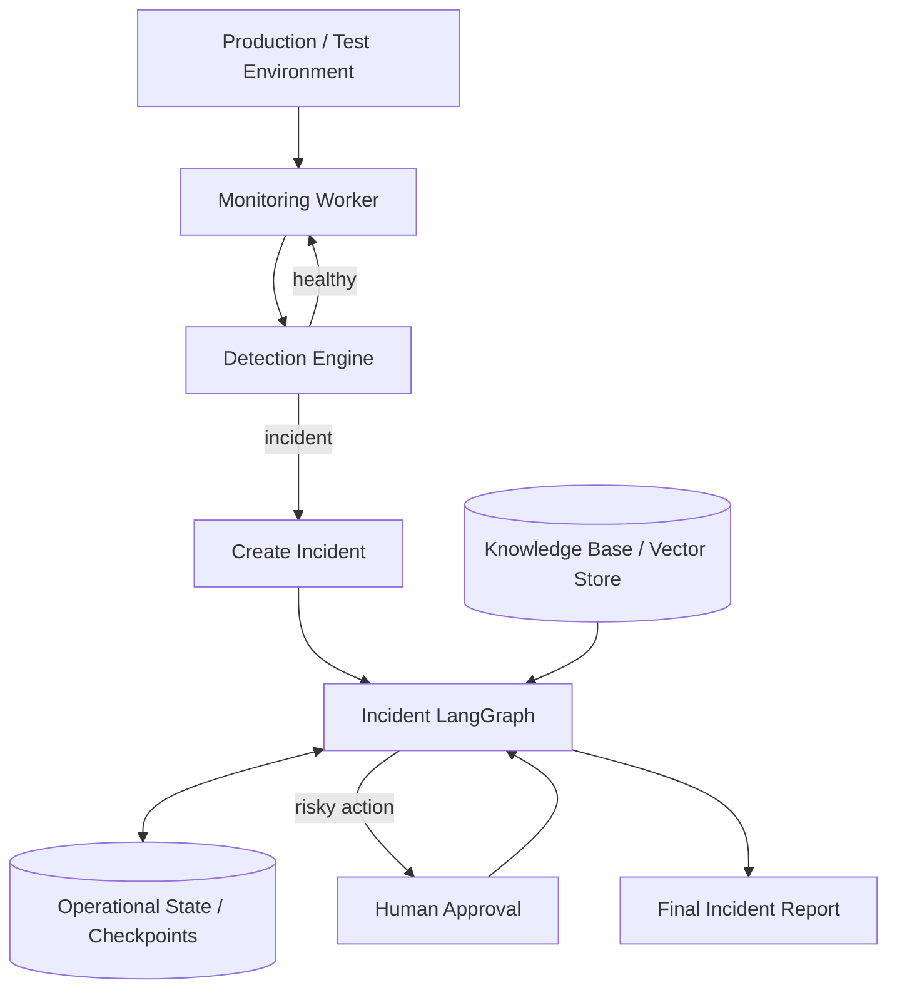

# System Architecture

> **V1 implementation scope:** Manually triggered, local without Docker, read-only investigation and recommendations. Detection/always-on monitoring, automatic remediation, and production integrations are later versions. RAG and MCP are added after the working evidence-to-RCA baseline. Existing code must be inspected before assuming interfaces exist.


## Purpose

AI Incident Intelligence is an always-on incident detection and investigation system.

Its job is to:

1. watch a running system,
2. detect meaningful anomalies,
3. create an incident,
4. investigate using operational evidence,
5. generate and verify hypotheses,
6. determine the most likely root cause,
7. recommend remediation,
8. require human approval for risky actions,
9. produce an evidence-backed incident report.

## High-level architecture



## Core layers

### 1. Production / test environment

The application being observed.

Current version:

- small FastAPI microservices,
- local processes,
- no Docker,
- local logs,
- `/health`,
- lightweight `/metrics`,
- local Git repository.

Future versions:

- Docker Compose,
- OpenTelemetry,
- Prometheus,
- Grafana,
- Jaeger,
- real GitHub,
- cloud or Kubernetes.

### 2. Monitoring worker

Runs continuously when monitoring is ON.

Responsibilities:

- poll service health,
- collect lightweight metrics,
- track recent errors,
- evaluate thresholds or anomaly rules,
- pass suspicious events to the detection engine.

Important:

> Monitoring is always-on. The LLM investigation is not.

The expensive investigation graph should wake only when an incident is created.

### 3. Detection engine

Initially deterministic.

Examples:

```text
error_rate > threshold
latency > threshold
service unhealthy
repeated timeout count > threshold
```

Later it may include statistical anomaly detection or a bounded decision model.

### 4. Incident LangGraph

Per-incident event-driven graph.

Core path:

```text
Intake
  ↓
Planner
  ↓
Investigation
  ↓
Evidence Aggregation
  ↓
Knowledge Retrieval
  ↓
Hypothesis Generation
  ↓
Verification
  ↓
Root Cause
  ↓
Remediation
  ↓
Risk Gate
  ↓
Final Report
```

### 5. Agents

Agents are specialists, not arbitrary chatbots.

Recommended investigators:

- Log Investigator
- Metrics Investigator
- Git Investigator
- Deployment Investigator
- Trace Investigator — later
- Database Investigator — later
- Docker / Kubernetes Investigator — later

Only create an agent when the domain needs distinct tools, context, or reasoning.

### 6. MCP

MCP is the tool-access layer.

```text
Agent
  ↓
MCP Client
  ↓
MCP Server
  ↓
Real operational system
```

Initially normal Python functions should be used first.

MCP is added after the interfaces are stable.

### 7. RAG

RAG provides organizational memory.

Sources:

- runbooks,
- historical incidents,
- architecture docs,
- service docs,
- troubleshooting notes,
- deployment guides,
- operational policies.

RAG is context, not ground truth.

### 8. Evidence layer

Evidence is the shared truth of the investigation.

Every important conclusion should point to evidence IDs.

Example:

```text
E-101  payment error rate rose to 18%
E-102  catalog service health failed
E-103  orders began timing out after catalog failure
E-104  no deployment occurred in the previous hour
```

### 9. LLM

Use LLMs for open-ended reasoning:

- investigation planning,
- evidence summarization,
- hypothesis generation,
- missing-evidence reasoning,
- RCA explanation,
- remediation proposals,
- final report generation.

### 10. Jev or bounded decision model

Use later for narrow decisions:

- classify,
- choose,
- score,
- route,
- verify,
- gate.

Examples:

```text
incident-worthy?
severity?
which hypothesis is strongest?
is evidence sufficient?
action risk = low / medium / high?
```

### 11. Persistence

Persist:

- incident state,
- graph checkpoints,
- evidence,
- hypotheses,
- approvals,
- final reports,
- investigation metrics.

A relational DB such as PostgreSQL is appropriate later.

### 12. Human authority

Humans remain authoritative for dangerous or irreversible actions.

Recommended rule:

```text
read-only investigation → autonomous
recommendation → autonomous
risky write action → human approval
```

## Architectural boundary to preserve

```text
LangGraph / Agents
        │
        ▼
Standard Tool Interfaces
        │
        ▼
Providers / MCP
        │
        ▼
Actual Environment
```

The graph should not care whether evidence comes from:

- local files,
- Docker,
- Prometheus,
- OpenTelemetry,
- GitHub,
- Kubernetes,
- cloud APIs.

That portability is a key design goal.
