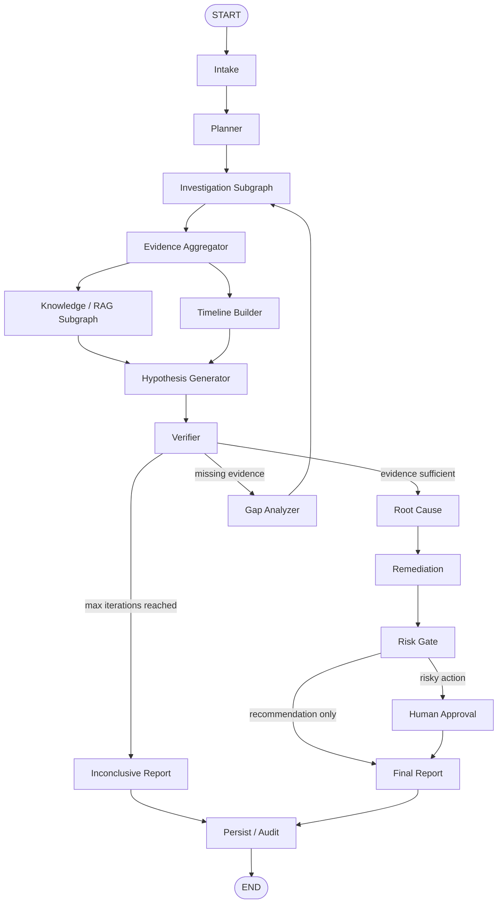

# LangGraph Architecture

> **V1 implementation scope:** Manually triggered, local without Docker, read-only investigation and recommendations. Detection/always-on monitoring, automatic remediation, and production integrations are later versions. RAG and MCP are added after the working evidence-to-RCA baseline. Existing code must be inspected before assuming interfaces exist.


## Principle

Use one main **IncidentGraph** per incident.

Do not use LangGraph as the infinite monitoring loop.

```text
Always-on Monitoring Worker
          ↓
Detection Engine
          ↓
Incident created
          ↓
IncidentGraph invoked
```

## Main graph



## Nodes

### Intake

Transforms the incoming incident into structured state.

Input:

```text
incident_id
title
description
detected signals
affected services
start time
severity
```

Output:

- normalized incident,
- initial investigation context.

### Planner

Decides which evidence domains matter.

Examples:

```text
latency spike
→ metrics + logs + traces

failure after release
→ deployments + Git + logs

database symptoms
→ metrics + logs + DB evidence
```

Planner should route only to relevant investigators.

### Investigation Subgraph

Collects evidence.

Potential investigators:

```text
Logs
Metrics
Git
Deployments
Traces
Database
Infrastructure
```

### Evidence Aggregator

Normalizes investigator results into a shared evidence schema.

It should:

- deduplicate,
- assign evidence IDs,
- preserve timestamps,
- preserve raw references,
- avoid turning interpretations into facts.

### Timeline Builder

Sorts important events chronologically.

Example:

```text
10:01 deployment
10:04 latency starts rising
10:05 catalog health fails
10:06 order timeout rate rises
10:08 alert fired
```

### Knowledge / RAG Subgraph

Retrieves relevant historical and procedural knowledge.

It should not decide the root cause itself.

### Hypothesis Generator

Generates multiple competing explanations.

Example:

```text
H1 Catalog service outage
H2 Recent Orders deployment regression
H3 Database saturation
```

### Verifier

For every hypothesis, record:

- supporting evidence IDs,
- contradicting evidence IDs,
- missing evidence,
- confidence / support score.

Do not accept an LLM answer simply because another LLM says it agrees.

### Gap Analyzer

If evidence is insufficient:

```text
What exact evidence would distinguish H1 from H2?
```

Then request targeted investigation.

### Root Cause

Produces an evidence-backed conclusion.

Required structure:

```text
root cause
why it happened
affected services
supporting evidence IDs
contradicting evidence considered
confidence
```

### Remediation

Proposes:

- immediate mitigation,
- short-term fix,
- long-term prevention.

### Risk Gate

Routes recommendations/actions.

```text
recommendation only → report
low-risk approved automation → optional execution
medium/high risk → human approval
```

### Persist / Audit

Save:

- state,
- evidence,
- node decisions,
- final report,
- tool calls,
- timing,
- failures.

## Conditional routing

### Planner routing

Only call necessary investigators.

### Verification routing

```text
enough evidence
→ root cause

missing evidence
→ gap analyzer → targeted investigation

contradictory evidence
→ further verification

max iteration reached
→ inconclusive report
```

### Risk routing

```text
read-only
→ safe

recommendation
→ report

write action
→ risk classification

high impact / irreversible
→ human approval
```

## Iteration control

Never allow an unlimited reasoning loop.

Suggested initial setting:

```text
max_iterations = 3
```

If still unresolved:

```text
status = inconclusive
```

The system should be allowed to say:

> Available evidence is insufficient to determine a reliable root cause.
