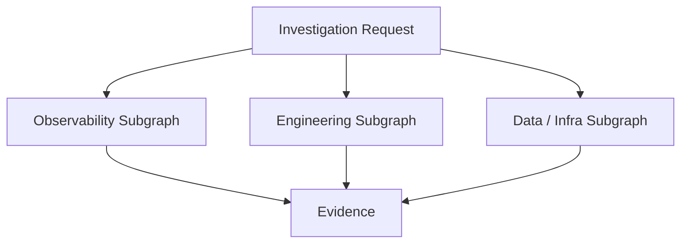
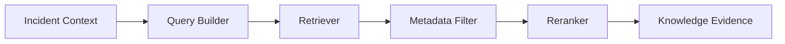
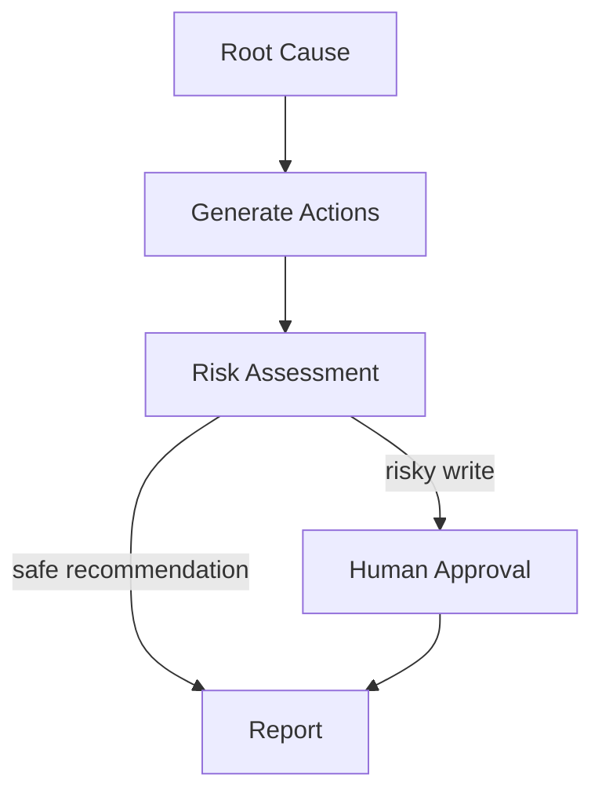

# Subgraphs and Agents

> **V1 implementation scope:** Manually triggered, local without Docker, read-only investigation and recommendations. Detection/always-on monitoring, automatic remediation, and production integrations are later versions. RAG and MCP are added after the working evidence-to-RCA baseline. Existing code must be inspected before assuming interfaces exist.


## V3 decision: two orchestrators, agents within each (future only)

The `Main IncidentGraph` below documents the **earlier combined conceptual design**. For V3 the top-level architecture is instead:

```text
INVESTIGATION ORCHESTRATION (LangGraph A)
  Investigation Coordinator Agent
  ├── Observability Agent → logs / metrics / traces (read MCP)
  ├── Engineering Agent → Git / deployments (read MCP)
  ├── Infrastructure Agent [optional] → DB / Docker / K8s (read MCP)
  ├── Evidence Aggregator [deterministic]
  ├── Knowledge / RAG Retriever [node/tool]
  ├── Hypothesis Agent
  └── Independent Verification Agent → bounded gap loop, RCA or inconclusive
                  |
          VERSIONED SHARED INCIDENT STATE
                  |
RESOLUTION ORCHESTRATION (LangGraph B)
  Resolution Coordinator Agent
  ├── RCA Validation Agent
  ├── Remediation Planning Agent
  ├── Risk Assessor [advisory]
  ├── Policy + Human Approval Gate [deterministic / human]
  ├── Execution Agent [approved sandbox only; write MCP]
  ├── Recovery Verification Agent [independent read MCP]
  └── Report / Audit / Closure [deterministic]
```

**Not every specialist requires an LLM:** subagents need separately scoped reasoning, tools and structured outputs. A log collector and a metrics fetcher can remain tools inside an Observability Agent; aggregation, policy and persistence are ordinary nodes. The complete V3 agent contracts, MCP servers, RAG/Jev placement, safety design and milestones live in `ARCHITECTURE/08_V3_DUAL_ORCHESTRATION_MULTI_AGENT.md`. V1 implementation is unchanged.

## Why subgraphs?

The main incident graph should stay readable.

Instead of one giant flat graph:

```text
Main IncidentGraph
    │
    ├── InvestigationSubgraph
    ├── KnowledgeSubgraph
    └── RemediationSubgraph
```

## 1. Investigation Subgraph



### Observability Subgraph

```text
Log Investigator
Metrics Investigator
Trace Investigator [later]
```

#### Log Investigator

Purpose:

- search errors,
- search by service/time window,
- identify repeated exceptions,
- detect correlated error patterns.

Should return structured evidence.

#### Metrics Investigator

Purpose:

- latency,
- error rate,
- request rate,
- CPU,
- memory,
- connection counts,
- service-specific metrics.

#### Trace Investigator

Later:

- identify slow spans,
- failing downstream services,
- request propagation,
- cross-service causal paths.

## 2. Engineering Subgraph

```text
Git Investigator
Deployment Investigator
```

### Git Investigator

Looks for:

- recent commits,
- changed files,
- diffs,
- relevant code changes,
- timing correlation.

### Deployment Investigator

Looks for:

- recent releases,
- deployment timestamps,
- version changes,
- rollback history,
- failed deployment signals.

## 3. Data / Infrastructure Subgraph

Future:

```text
Database Investigator
Docker Investigator
Kubernetes Investigator
Cloud Investigator
Network Investigator
```

These should be added only when the environment supports them.

## 4. Knowledge Subgraph



Purpose:

- find related incidents,
- fetch runbook steps,
- retrieve architecture knowledge,
- retrieve service ownership/dependency context.

## 5. Remediation Subgraph



## Agent design rule

Do not create agents just because multiple agents look impressive.

Create a separate agent when at least one is true:

1. it owns a distinct toolset,
2. it reasons over a distinct evidence domain,
3. it needs a separate prompt/policy,
4. it benefits from independent parallel execution.

Otherwise use a normal function/node.
