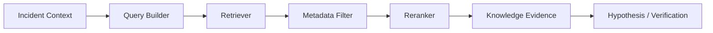

# RAG Architecture

## Purpose

RAG gives the incident system organizational memory.

Operational evidence tells the system:

> What is happening now?

RAG tells the system:

> What does the organization already know that may help explain this?

## Knowledge sources

Possible documents:

- runbooks,
- architecture documents,
- service documentation,
- troubleshooting guides,
- historical incident reports,
- deployment guides,
- operational policies,
- known failure patterns.

## Flow



## Metadata

Useful metadata:

```text
service
document_type
incident_type
date
version
team
environment
severity
```

## Important distinction

### MCP

Live/current systems:

```text
logs
metrics
traces
Git
deployments
infrastructure
```

### RAG

Stored organizational knowledge:

```text
runbooks
historical incidents
architecture docs
service docs
policies
```

## RAG is evidence, not truth

Historical documentation can be:

- stale,
- incomplete,
- wrong,
- specific to an older version.

Therefore retrieved knowledge should enter the same verification process as other evidence.

## Evaluation contamination

Never put the exact ground-truth answer for an evaluation incident into the RAG corpus.

Otherwise the system may simply retrieve the answer instead of investigating.
