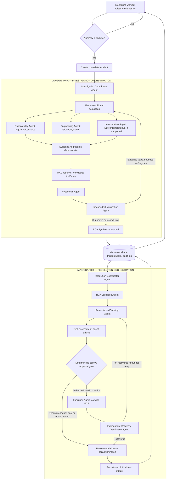

# V3 — Dual-Orchestration Multi-Agent Architecture (Future Target)

> **Status: DESIGN / NOT IMPLEMENTED.** This specifies the V3 target architecture, not the current running system. At the October 2026 handoff, the V1 LangGraph implementation ends after evidence collection/aggregation. V1 Stage 4 (hypothesis and verification) and Stage 5 (RCA/reporting) remain the immediate development work. Preserve all V0–V1 behavior, tests, adapters, and public contracts when introducing later versions.

## 1. Architectural decision

V3 is a **hierarchical multi-agent incident investigation and resolution system** with **two separate, cooperating LangGraph workflows**:

1. **Investigation Orchestration** — coordinates specialist investigation agents, evidence aggregation, competing hypotheses, independent verification, and an evidence-backed RCA or explicitly inconclusive outcome.
2. **Resolution Orchestration** — consumes an immutable/validated investigation outcome, coordinates resolution specialists, plans safe action, obtains authorization, optionally executes approved sandbox/allowlisted actions, verifies recovery, and closes or escalates the incident.

They communicate through a **persisted, versioned IncidentState / handoff record** keyed by `incident_id`, not by unverified agent-to-agent chat. The monitoring/detection service is an **outside-the-graph deterministic worker** that wakes the investigation workflow only for meaningful incidents. A single LLM need not run 24/7.

## 2. Full target graph



**Routing notes:** An inconclusive investigation cannot silently authorize execution; resolution may only report, request more evidence, or escalate. The investigation loop retains the V1 maximum of **three cycles**. Resolution retries are separately bounded and must not reuse an approval for a changed action. The diagram illustrates conditional specialists, not a requirement to execute every agent for each incident.

## 3. Agents vs ordinary nodes/tools

| Component | Role | Agent or deterministic? | Access |
|---|---|---|---|
| Investigation Coordinator | Select relevant investigation tasks; delegate and combine findings | Agent | Read-only tool routing |
| Observability Specialist | Reason over relevant logs/metrics/traces; choose queries | Agent when independent reasoning is needed | Observability MCP (read) |
| Engineering Specialist | Correlate Git diffs/deployments with timing | Agent when justified | Engineering MCP (read) |
| Infrastructure Specialist | Diagnose DB/container/Kubernetes/cloud signals | Optional agent, provider-dependent | Infrastructure MCP (read) |
| Evidence Aggregator | Normalize IDs/provenance, dedupe, construct timeline | **Deterministic node** | Shared state |
| Knowledge Retriever | Retrieve/runbook and historical-incident context | **RAG tool/node by default** | Knowledge store, optional Knowledge MCP |
| Hypothesis Agent | Form several testable causal hypotheses | Agent | Normalized evidence and RAG context |
| Independent Verification Agent | Check support/contradictions/missing evidence; request targeted follow-up | Agent | Evidence IDs and read-only tools |
| RCA Synthesis | Ground conclusion, uncertainty, incident handoff | Agent or bounded structured-output node | Verified evidence only |
| Resolution Coordinator | Delegate validation/planning; track approvals and outcomes | Agent | Resolution read interfaces |
| RCA Validation Agent | Verify evidence links and action prerequisites before plans | Agent | IncidentState / read-only tools |
| Remediation Planning Agent | Propose alternatives, mitigations, rollback and verification criteria | Agent | RAG/runbooks and read interfaces |
| Risk Assessment | Suggest impact and reversibility | Agent or bounded model | Policy inputs; cannot authorize writes |
| Policy / Human Approval Gate | Enforce exact action permission, risk policy, scope and identity | **Deterministic gate + human** | Authorization system |
| Execution Agent | Call only approved, allowlisted sandbox remediation tools | Agent when tool choice is needed; otherwise tool node | Write-capable Remediation MCP |
| Recovery Verification Agent | Independently check outcome vs baseline | Agent | Read-only Observability/Infrastructure MCP |
| Report / Audit | Persist decision trace, evidence, approval and outcome | **Deterministic node** (LLM may draft prose) | Storage/notifications |

A **node is not automatically an agent**. Distinct agent roles require their own goal, bounded decisions, relevant context/tool permissions, and testable outputs; use plain nodes for collection, normalization, gates, persistence, and polling when reasoning is unnecessary. Specialists may share one LLM provider while retaining separate prompts, tool access, and state boundaries.

## 4. Subgraphs and aggregation boundaries

- **Investigation graph:** Intake → Coordinator → **Observability**, **Engineering**, optionally **Infrastructure** subgraphs → deterministic **Evidence Aggregator** → RAG retrieval → Hypothesis Agent → Verification Agent → bounded gap loop → RCA/handoff or inconclusive.
- **Resolution graph:** Coordinator → RCA Validator → Planning → risk assessment → policy/human approval → optional Execution Agent → independent Recovery Verification → closure/escalation and report.
- **Aggregation:** EvidenceAggregator merges factual tool records and preserves provenance; the investigation outcome is aggregated into a **verified RCA handoff**; the resolution report merges action proposals, approvals, executions, post-action evidence and final status. Never treat speculative agent text as factual telemetry.

## 5. Shared state and handoff contract (illustrative, not current code)

The existing canonical V1 `IncidentState` remains the starting point. Extend its schema **only when the related future capability is implemented**. The V3 cross-graph handoff should minimally communicate:

```text
incident_id, incident_version, lifecycle_status, affected_services
trigger_signals, observed_evidence[] (IDs + source/provenance/timestamps)
hypotheses[] (support/contradiction IDs, unknowns, confidence/uncertainty)
root_cause | inconclusive_outcome, verification_summary
recommended_actions[] (risk, preconditions, rollback, verification checks)
authorization[] (who/what/when/scope/expiry), execution_attempts[]
recovery_evidence[], final_outcome, report_reference, audit_events[]
```

- Incident version/checkpoint and correlation ID make orchestration handoff **idempotent**; concurrency must not silently overwrite evidence or approvals.
- Resolution only consumes explicitly **verified, versioned** outcomes. For an inconclusive result, present recommendations for further investigation instead of pretending a confirmed cause.
- Reports must reference actual tool evidence IDs; RAG passages and LLM hypotheses are **context/inference**, not operational ground truth.
- An action or its parameters changing invalidates earlier approval; approval must be narrowly scoped, revocable, recorded and checked by the server at execution time.
- Never feed hidden evaluation answer keys, secrets or unrestricted raw credentials into prompts or retrieval.

## 6. Tool, MCP, RAG, LLM and Jev placement

```text
Investigation / Verification / Recovery agents
      |  read-only tool contracts
      +--> MCP client --> Observability MCP --> logs / metrics / health / traces
      +--> MCP client --> Engineering MCP --> commits / diffs / deployment history
      +--> MCP client --> Infrastructure MCP (later) --> DB / Docker / K8s / cloud
      +--> RAG retriever (optional Knowledge MCP) --> runbooks / past incidents

Resolution Planning Agent --> read-only evidence and RAG
Risk assessor / Jev (optional) --> bounded risk proposal
Deterministic policy + human approval --> scoped authorization
Approved Execution Agent --> guarded MCP client --> Remediation MCP (write)
Recovery Verification Agent --> independent READ MCP --> actual health/metrics
```

**LLM**: adaptive planning, hypotheses, causal explanations, remediation options. **Jev / bounded classifier (optional)**: alert triage, service/severity routing, hypothesis prioritization, evidence sufficiency *advice*, risk classification *advice*; it is never the sole permission or safety authority. **RAG**: historical/organizational context, never an evidence substitute. **MCP**: tool transport and authorization boundary, not an agent or reasoning engine. **LangGraph**: graph orchestration, conditional routes, state/checkpoints, retries. **Plain Python**: polling, normalization, aggregators, rules and hard gates.

Build tools as tested provider-independent Python functions first; wrap stable interfaces with MCP without rewriting each agent. V3 baseline should expose **at least Observability and Engineering read-only MCP servers**. Additional MCP servers are conditional on supported environments; a write-capable Remediation MCP is a later, guarded V3 subphase, not a V1 prerequisite.

## 7. Safety, autonomy and failure behavior

1. Monitoring remains cheap, deterministic and always-on only when enabled; no permanent LLM execution loop.
2. Read-only investigation may proceed autonomously; no destructive action is justified by an agent's confidence alone.
3. **Human approval is mandatory for consequential writes** in the V3 demo; the write MCP independently enforces allowlist, identity, target, time-bound approval, idempotency and audit.
4. Start remediation execution with a **simulated/local test target**, not live production systems. Denial, timeout, tool failure or missing telemetry must preserve a safe non-executing state.
5. The **Recovery Verification Agent** must check measured service behavior with fresh evidence, not accept the Execution Agent's success text as proof. Failed recovery escalates or initiates a separately approved/limited rollback path.
6. Preserve complete action, model and tool audit records with appropriate redaction. Escalate on ambiguous RCA, expired approvals, unresolved loops, unsupported MCP capabilities or unsafe plans.

## 8. Incremental implementation plan — does not alter completed stages

| Milestone | Implementation direction | Acceptance evidence |
|---|---|---|
| **V1 ongoing** | Finish existing Stage 4 LLM hypotheses and verification; Stage 5 evidence-cited RCA/recommendations/report; optional MCP/RAG in their planned stages; V1 evaluation | Existing regression suite remains green; manual incident flow works |
| **V2** | Accept external alerts/webhook, dedupe and automatically trigger **existing** investigation, without always-on self-monitoring | One alert creates one correlated investigation; no production actions |
| **V3-A** | Add cheap monitoring worker, detection, monitoring ON/OFF and incident lifecycle/checkpoints | Background polling detects fixture failures without running continuous LLM |
| **V3-B** | Formalize investigation specialist agent interfaces and Coordinator; parallel/conditional delegation; preserve deterministic aggregation | Traced delegated tasks and evidence provenance; <=3 verification cycles |
| **V3-C** | Integrate tested Observability and Engineering read-only MCP servers; RAG retrieval and optional Jev gates where evaluated | Contract tests, permission tests, graceful MCP outages; no invented evidence |
| **V3-D** | Split **ResolutionGraph** from InvestigationGraph using versioned RCA handoff; add RCA Validator and Planning agents | Separate LangGraph invocations, resumability and correct inconclusive routing |
| **V3-E** | Add deterministic risk gate, explicit human approval, simulated/allowlisted execution MCP and independent recovery verification | Refused/unapproved actions never execute; audit, failure/rollback scenarios pass |
| **V3-F** | Dashboard, incident history, reporting and end-to-end multi-agent evaluation | Demonstrated incident → both graphs → approved test action/verification → report |
| **V4/V5 later** | Multi-tenancy, real production adapters, deeper security/Jev/reliability | Tenant isolation, organizational policies, enterprise evaluations |

**V3 definition of done:** two separately runnable/coordinated LangGraph workflows; meaningful independent specialist agents; persisted shared incident handoff; tested read-only MCP integration; evidence-backed or inconclusive investigation; governed remediation plan and approval-gated sandbox execution (if enabled); independent recovery verification; functioning continuous *non-LLM* monitoring; auditable end-to-end demonstrations. V3 must also work in **recommendation-only mode** without granting write permissions.

**Scope boundary:** This document is a forward plan. Do **not** change `investigation/`, `common/`, `services/`, tests, dependencies, Git history or existing V1 stage acceptance criteria merely to align documentation.
