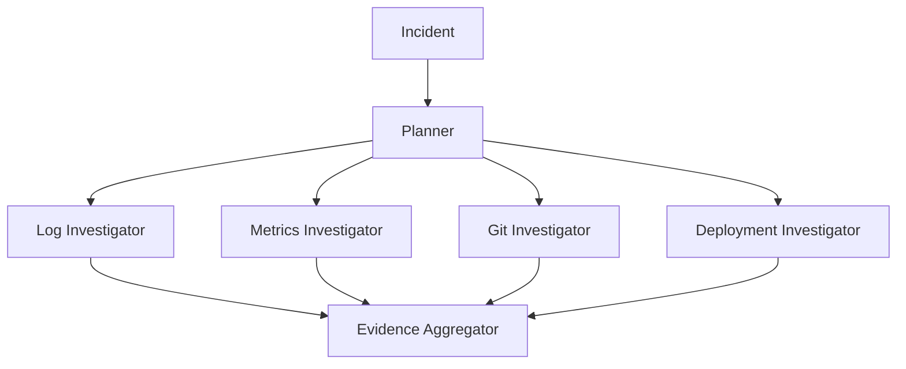

# Investigation Flow

## Goal

Convert an incident signal into structured operational evidence.

## Flow



## Planner output example

```json
{
  "investigators": [
    "logs",
    "metrics",
    "git"
  ],
  "time_window_minutes": 30,
  "services": ["orders", "catalog"],
  "questions": [
    "Did catalog fail before orders?",
    "Was there a recent relevant code change?"
  ]
}
```

## Investigator contract

Every investigator should return:

```text
evidence[]
errors[]
coverage
```

Not:

```text
one giant free-form answer
```

## Example Log Investigator output

```json
{
  "evidence": [
    {
      "id": "E-12",
      "source_type": "log",
      "source": "orders",
      "summary": "Repeated connection failures to catalog began at 10:22.",
      "raw_reference": "logs/orders.log#10:22-10:25"
    }
  ]
}
```

## Parallelism

Independent investigators can run in parallel.

Example:

```text
Logs
Metrics
Git
```

can often execute concurrently.

## Targeted second pass

After verification:

```text
missing evidence:
"Was Catalog already unhealthy before Orders started failing?"
```

The graph should request only the needed follow-up evidence.
