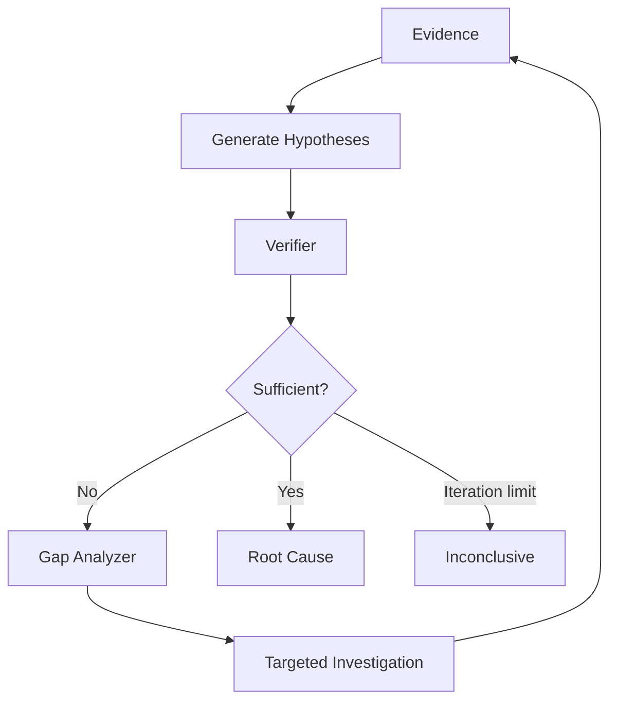

# RCA and Verification Flow

## Principle

Do not jump directly from evidence to one confident answer.

Use competing hypotheses.

## Flow



## Example hypotheses

```text
H1 Catalog service is down
H2 Orders deployment introduced a regression
H3 Database latency is causing downstream timeouts
```

## Verification structure

For each hypothesis:

```text
claim
supporting evidence IDs
contradicting evidence IDs
missing evidence
confidence
```

## Strong verifier behavior

Example:

```text
H1 supported by:
E-10 catalog health failed
E-12 orders connection errors point to catalog
E-17 catalog failure began before orders errors

H1 contradicted by:
none

H2 supported by:
E-20 a deployment occurred earlier

H2 contradicted by:
E-21 deployment was 9 hours before incident
E-22 changed files unrelated to request path
```

## Evidence sufficiency

Do not define sufficiency as:

> the LLM sounds confident.

Define it structurally.

Possible requirements:

```text
at least 2 independent supporting signals
causal timing is plausible
major competing hypothesis considered
no critical missing evidence
```

## Inconclusive path

If evidence remains insufficient after the iteration cap:

```text
status: inconclusive
```

Report:

- what is known,
- what is unknown,
- what additional evidence would resolve it.
